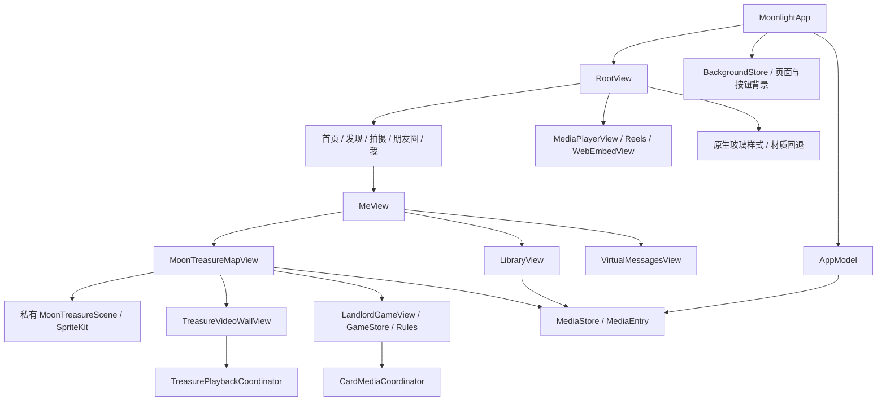

# 双视角自由媒体沙盒：P0 工程审计

日期：2026-11-02。范围：任务书 V1.0 的 P0；本阶段仅增加审计文档和只读辅助脚本，不实现 RPG，不改业务代码，不生成新 IPA。

## 1. 结论与事实边界

现有工程适合以独立功能模块增量接入。保留五个主 Tab，从「我」增加独立入口；月藏图、媒体库、消息、既有斗地主保持原状，斗地主后续开发暂缓。

当前仓库有 SwiftUI 容器、SpriteKit 卡片场景、可引用的媒体库、原生玻璃兼容层，以及多个页面级播放器池。**尚未找到任务书定义的世界、Chunk、双视角、建造、即时战斗或剧情引擎实现。** 现有卡片场景不是可直接复用的 RPG 世界。

标记约定：**事实**来自本次源码/配置检查或明确的 GitHub 历史记录；**建议**是后续设计，未实现；**待验证**需未来测试，不能视为现有能力。静态声明扫描不等于运行验证。

- 审计起点：`22dfc109386e092dc86a6dc649d014079893563b`，原分支 `feature/treasure-map-v2-4-1`。
- P0 独立分支：`docs/rpg-sandbox-p0-audit`。基于现有功能分支，不能假定 main 已包含这些功能；本轮不合并分支。
- 已验证应用源码：`01bd5a7cef0e3e51aa7b9dfe10ee2f4b1e83dce1`。其后至审计起点只修改 CI 去重与验收文档。
- 清单：[P0_SOURCE_INVENTORY.json](P0_SOURCE_INVENTORY.json)。21 个根目录应用 Swift 文件，工程有 22 个 Swift 文件引用（含 1 个 UI 测试文件），文件引用全部存在；38 个不同 UI 测试方法。
- 本地为 Linux，没有 `xcodebuild`、`swiftc`；本轮没有执行 iOS 编译、Swift 测试或真机测试。历史 CI 成功不代表 RPG 已编译或已达到 60 FPS。

## 2. 实际结构、平台和依赖

| 项目 | 已核对的事实 | 对后续接入的影响 |
|---|---|---|
| 工程 | [project.pbxproj](../../Moonlight-iOS.xcodeproj/project.pbxproj)，共享 scheme 为 `Moonlight` | 新文件须加入 PBXGroup 和应用 Sources；当前不是自动同步目录 |
| Target | `Moonlight` 应用、`MoonlightUITests` UI 测试；无独立 XCTest 单元 target | 纯领域测试可先沿用独立 swiftc harness，不混入 UI target |
| 平台 | iOS 16.0；Swift 6.0；`TARGETED_DEVICE_FAMILY = "1,2"` | iPhone/iPad 配置存在；不等于两类设备都已验收 |
| 朝向 | [MoonlightApp.swift:17](../../MoonlightApp.swift#L17) 默认竖屏，仅 `playerAllowsLandscape` 允许媒体播放器横屏 | 双视角不等于屏幕旋转；P1 保持朝向，P4 如需横屏应单独设计所有权 |
| 编译 SDK | 源码引用 iOS 26 glassEffect，并以运行时可用性判断回退；CI 使用浮动的 macos-latest | 建议 P1 显式记录 Xcode/SDK 版本；运行时判断不代表旧 SDK 一定能编译这些符号 |
| 三方依赖 | 未见根目录 SPM/Pods/Carthage 清单，工程未见远程 Swift Package 引用 | 当前主要依赖 Apple 系统框架；不据此声称已审查第三方服务全部行为 |
| 框架 | SwiftUI/UIKit/Combine、SpriteKit、AVFoundation、CoreMotion、ImageIO/CoreImage，另有 PhotosUI、WebKit、Network、Security 等 | 领域模型不要依赖 SKNode、UIImage、AVPlayer 或网页容器 |
| 物理组织 | Swift 业务文件主要平铺根目录，`RootView.swift` 承载多个页面/交互类型 | 新功能建独立目录；不借机拆分或重写旧 RootView |

### 当前依赖图（实线均为现有关系）



图中没有 RPG 节点；P1 才会新增。`AppModel` 还负责虚拟好友、动态和命令等状态，不应成为 RPG 世界实体容器。

## 3. 五个 Tab、入口和隔离边界

**事实：** [AppTab](../../MoonlightApp.swift#L485) 固定为 home/discover/camera/moments/me；[RootView](../../RootView.swift#L105) 按 `selectedTab` 分发页面，并带原生底部导航、全局长按、智能搜索与多种媒体呈现路径。

[MeView](../../RootView.swift#L2890) 为私有类型，内部有自己的 NavigationStack。「库」入口位于 2935 附近；月藏图按钮标识为 `me-treasure-map`，通过独立 fullScreenCover 打开。朋友/消息仍用 NavigationLink；消息是现有虚拟互动摘要页面，不是 RPG 对话系统。

**建议：** P1 仿照独立全屏容器增加「自由媒体沙盒」入口，保持 `AppTab` 不变。新建 `RPGSession` 持有模块状态，仅注入媒体适配器；退出取消任务、暂停场景并回到「我」。不要借用月藏图的三模式开关，也不要复用斗地主状态保存键。

若新增 `AppCommand.rpg` 以维持搜索可达性，需同步标题、图标、搜索词与 RootView 的命令路由；不要让它落入 MeView 的默认 LibraryView 分支。多个全屏呈现请求须互斥，避免旧播放器和 RPG 同时呈现。

**待验证：** 全局/窗口级底栏和长按手势是否仍收到 RPG 区域的触摸。现有 UI 测试已覆盖导航触摸优先级，但不覆盖新 RPG 摇杆/绘制输入。优先隔离宿主控制器和命中区域，不能靠覆盖一层全屏透明视图解决。

## 4. MediaStore 与媒体复用

| 实际接口 | 可以复用 | 不能直接推导出的能力 |
|---|---|---|
| [MediaEntry](../../MediaServices.swift#L11)：稳定 `id`、kind、remoteURL、coverURL、embedURL | 世界中的 MediaBinding 只存媒体 ID 与显示参数 | `.video` 类型或 http URL 不保证可直接解码；平台视频可能是网页地址 |
| [MediaStore](../../MediaServices.swift#L484)：MainActor ObservableObject，`items` 只读发布 | 用只读适配器按 ID 查找库内条目；观察删除/更新 | 不应让世界生成器依赖整个 AppModel 或触发发现页刷新 |
| [importMedia](../../MediaServices.swift#L933) 返回 MediaEntry? | 导入成功后绑定返回的稳定 ID | Data 导入会持有完整数据，不能假设大视频低峰值内存 |
| [importVideoFile](../../MediaServices.swift#L951) 复制到沙盒，返回 Void | 可参考现有文件导入策略 | 「文件导入后直接绑定」需要明确结果接口；不靠比较数组下标猜新 ID |
| [delete](../../MediaServices.swift#L1015) 删除条目和受控 media 目录内的文件 | 缺失绑定回退默认外观/封面并保留世界实体 | 世界引用不会阻止库删除文件，不能把绑定误作文件所有权 |
| [persist](../../MediaServices.swift#L1046) 原子写 JSON | 可参考单文件原子替换模式 | 无世界差量/事务日志/备份恢复；`try?` 也不是世界保存错误反馈策略 |

现有照片选择路径位于 RootView 386 附近，使用 PhotosPicker/loadTransferable；本地文件位于 Application Support 的 media 目录。MediaEntry 本身不是 Photos 资产授权令牌，RPG 需检查实际文件/播放能力，不能因有 ID 就声称授权有效。

**建议协议边界：** `RPGMediaCatalog` 返回素材描述/可用性；`RPGMediaPresentation` 管理帧/封面；`MediaBinding` 编码裁切、锚点、缩放、loop/mute 等纯数据。协议名和形状待 P1 编码确定，本轮未新增 Swift 类型。世界文件不内嵌视频字节，不持久化播放器、纹理或绝对沙盒媒体路径；按 ID 重新解析路径。

离线玩法只能依赖已存在的本地素材及默认外观；远程封面/直播/嵌入网页不算离线资源。缺失素材不能改变角色碰撞盒或阻断世界载入。

## 5. SpriteKit、视频、玻璃与生命周期

### SpriteKit

[MoonTreasureScene](../../MoonTreasureMapView.swift#L307) 是文件私有卡片场景：动态矩形物理体、边框碰撞、倾斜重力、摇晃、拖动、长按及卡片预览。`startMotion` 启用 CoreMotion，`stopMotion` 释放拖动并停运动；这些操作属于自由散落。

**建议：** 仅参考 SpriteView 嵌入、触摸所有权、退出清理等模式。新建独立 `RPGTopDownScene` / `RPGSideScene`。俯视和侧视独立设置重力、碰撞类别、相机与命中体积；不把原场景改名后用于 RPG，不把 CoreMotion 倾斜重力带入默认俯视探索。

### 视频

| 现有所有者 | 当前策略（源码事实） | RPG 适用性 |
|---|---|---|
| 自由散落 `TreasureVideoPreviews`，同文件 897 附近且私有 | 最多 3 个 AVQueuePlayer，验证 isPlayable，静音循环，stopAll | 参考生命周期；无法跨文件直接当公共池使用 |
| 视频墙 `TreasurePlaybackCoordinator` | 选择上限 10；动态预算按策略为 1–6，离屏/中断处理 | 与世界角色/背景优先级不同，不改变它的 10 项选择语义 |
| `CardMediaCoordinator` | 0–2 路素材共享；320 像素帧；24 项/12 MiB LRU；内存警告缩至 6 项/2 MiB；显式声音与退出清理 | 参考共享、缓存、代次防过期回调和降级；预算/预览角色写死卡牌，不能直接替换为角色池 |
| 普通播放器/Reels、页面/头像/按钮背景 | 各有 AVPlayer/AVPlayerLayer 或队列生命周期 | 不受上面单个池的总量控制 |

**事实：没有在这些实现中发现统一的全 App 解码许可池。** [BackgroundMediaLayer](../../Backgrounds.swift#L414) 主要按场景激活、低电量、减少动态效果及 paused 决定是否显示视频，不能据此证明被新全屏 RPG 遮住的背景一定停解码。

**建议：** P1 不启动视频，只定义协议。P5 建独立 RPG 预算与所有权，进入/退出时明确暂停原页面的不可见视频，保护原配置。背景 1 + 玩家 1 + 互动最多 2 是任务书的实验角色上限，不能当作已验证的全进程并发数；共享素材只占一次解码，按设备/可见性/帧时间进一步限制总量。任何扩容需实机数据，不沿用卡牌测试证明 RPG 可稳定运行 4 路。

需覆盖 UIApplication 前后台、音频中断、返回静音、素材失效、热状态、内存警告及迟到回调。退出清理输出、通知、任务和引用；不要每个方块常驻一个播放器。

### 玻璃

复用 [MoonGlassBackdrop](../../MoonGlass.swift#L12)、`moonSingleGlass` 和现有按钮样式：iOS 26+ 调用原生 glassEffect，iOS 16–25 系统 regularMaterial；减少透明度时采用系统实体色，增强对比度时加边框。

玻璃只用于操作界面与必要 HUD；地形、敌人和物理场景不强制玻璃化。控制容器与子按钮遵循现有单层环境标记，不堆叠多个材质层。

## 6. 双视角与 65,536 地表格的关键模型

以下均为**建议/待实现**，不是已存在的系统。

1. `WorldState` 保存 schemaVersion、seed、generatorVersion、实体 ID、地表、区块元数据、修改日志、玩家/剧情状态和媒体引用。逻辑层不用 CGPoint/SKNode/AVPlayer 编码。
2. 地表坐标明确为 `(x,z)`，范围各 `0..<256`；Chunk 坐标 `(x/32,z/32)`，各 `0..<8`，局部坐标为余数。算术是 65,536 格、64 Chunk、每块 1,024 格；本轮仅核对算术，没有生成世界。
3. 俯视投影读取地表占用、导航和自己的碰撞配置。侧视投影读取明确 `regionID`、地表映射范围、水平轴、独立高度与安全落点；侧视坐标称 `(u,y)`，避免把世界 z 当 y。
4. shared 对象使用同一 entityID，映射描述给出它在指定侧视区域的布局位置。无法单值映射的对象必须排除或明确规则，不能将一条地表列的多个 z 格静默挤到同一侧视位置。
5. sideOnly 平台/装饰归侧视区域所有；topDownOnly 对象不产生侧视实体；明确共享对象的规范归属和 Chunk 索引。不得把侧视高度误用于地表 Chunk 索引。
6. 建造、伤害与删除提交领域事务，日志以 entityID/坐标为目标；再次进入任一投影从规范状态重建，避免维护两份互不一致的「真实世界」。纹理尺寸与逻辑占格、碰撞盒分离。
7. 只在已声明的安全入口切换；验证战斗状态、映射存在、目标边界、碰撞与落点。先验证再提交投影/位置变更，失败维持原视角和状态，禁止先传送后补救。
8. 同 Seed/版本确定性需固定 PRNG 与稳定实体 ID 方案，并避免 Swift hashValue、无序字典遍历和随机 UUID 影响生成。Chunk 生成次序、缓存命中和异步完成顺序不应改变结果。新局 worldID 可以独立生成 UUID。

**性能设计风险：** 逻辑格数不是节点数。3×3 优先 Chunk 已含 9,216 格，若每格一个动态图节点/物理体再叠视频，负担很大。建议静态地表用 tilemap/批次纹理，合并静态碰撞，仅邻近实体使用动态节点；以相机可见范围加邻域流式调度，3×3 是候选策略，不是始终固定加载量。60 FPS、p95、峰值内存、解码数与切换延迟都仍需目标 iPhone 实测。

## 7. 持久化、事务与剧情前置条件

独立目录建议 `Application Support/RPG/<worldID>/`。MediaStore 的 JSON 和斗地主 UserDefaults 不能直接当作世界存档协议。

最小存档应有 schemaVersion、generatorVersion、seed、修订号、玩家差量及稳定实体/区域 ID；保存前校验边界、定义引用、投影约束和资源上限。先写临时文件，再原子替换并保留可验证备份；主文件损坏才尝试备份，不能静默重置有建筑的世界。升级 schema 与升级生成器是两种不同迁移。

**阶段依赖：** M1/P3 已要求保存建筑并在重启后保留，不能把所有存档能力推迟到 P9。P1 定义 codec/存储协议及序列化 fixture；P3 前置最小差量落盘、原子替换/备份和恢复验证，P9 再完成全世界+剧情迁移及故障恢复整合。

P7–P9 的奖励标记与对应世界变更须在同一领域事务边界内提交，校验失败回滚；只保存「已领奖」或只保存掉落都会产生崩溃窗口。行为与剧情动作使用白名单数据，不反序列化任意代码；未来导入 JSON 要检查大小、版本、引用、断链和无界循环。本轮没有实现或验证剧情执行器。

## 8. 推荐目录（P1 起创建，不迁移旧模块）

```text
Features/RPG/
  Domain/World/       # WorldState, 坐标、Chunk 元数据、投影描述
  Domain/Blocks/      # 定义、实例、能力与事务（后续 P3）
  Domain/Combat/      # 数值与领域事件（后续 P6）
  Domain/Story/       # 图/状态/白名单动作（后续 P7）
  Media/             # RPGMediaCatalog 适配器与后续预算所有者
  Rendering/         # 独立 SpriteKit 场景、摄像机、输入转换
  UI/                # RPGShellView、入口、HUD、后续编辑器
  Persistence/       # codec、存档协议、版本/备份策略
Tests/RPG/           # 独立纯 Swift harness 与 fixtures
```

现有工程无 `Moonlight/` 源码目录，因此直接从仓库根创建 `Features/RPG/` 即可，不为套目录名搬动全部 App。

**工具链风险：** `scripts/audit_controls.py` 当前仅扫描根目录 `*.swift`；新子目录控件不会被纳入。P1 应扩展为只扫描明确的应用源码目录，排除 build/Tests，而非把整仓递归文件都当 App。纯 Swift harness 的源文件需显式列入 swiftc，PBX 引用亦需同步更新。P0 辅助脚本按当前根目录组织扫描；进入嵌套目录后，应同步扩展清单范围，不能把这份 P0 快照当作后续 RPG 全量扫描。

## 9. P1 最小改动清单与阶段门槛

P1 只交付可进入/退出的空白骨架与数据协议，不提前做 P2–P10。

| 文件/边界（以下为计划路径） | P1 最小交付 | 验收 |
|---|---|---|
| `Features/RPG/UI/RPGShellView.swift` | 入口页、加载/错误/退出状态、原生玻璃按钮 | 从「我」打开再退出，五 Tab、库、消息、月藏图仍可使用 |
| `Features/RPG/RPGSession.swift` | 模块所有权、可取消任务、激活/暂停；仅状态变化发布 UI | 反复进入退出无残留场景/任务；不接管原模块状态 |
| `Domain/World/WorldState.swift` | Codable 的世界头、稳定 ID、坐标/边界和 Chunk 元数据 | 编解码往返、非法坐标/版本/引用拒绝，区分默认世界头与已生成世界 |
| `Domain/World/WorldProjection.swift` | shared/topDownOnly/sideOnly 与明确侧视区域映射协议 | 不把 x,z 直接旋转；不合法/不可映射数据可拒绝 |
| `Media/RPGMediaCatalog.swift` | 只读 MediaStore adapter，缺失/非本地/不可播放状态 | 引用成功与缺失回退；无新播放器、无发现页网络刷新 |
| `Persistence/RPGWorldCodec.swift` | 编解码和存储协议/测试替身 | 只做 schema 基础；不宣称已满足 M1 存档恢复 |
| `Rendering/RPGTopDownScene.swift` | 空白占位场景、基础相机与显式暂停/销毁 | 无 65,536 节点、无建造/敌人/视频，不冒充 P4 双视角 |
| `RootView.swift` | MeView 一个独立入口与互斥呈现；保持原入口 | 不增加第六 Tab、不使用月藏图三模式来装 RPG |
| `MoonlightApp.swift` / Root 命令分支 | 如接搜索，新增 `.rpg` 的标题/图标/关键词/路由 | 搜索到 RPG 不误入库；不得遗漏 enum 分支 |
| project.pbxproj / harness / CI | 注册新目录 Swift 文件、领域测试和入口 UI 用例；补嵌套控件清单 | GitHub 编译、模型序列化、入口/退出与原模块回归 |

P1 用例应覆盖序列化、负坐标/256 边界、Chunk 的 31→32 和 255 边界、重复 ID、未知 schema、投影 scope/映射校验、缺失媒体、入口/退出、原五 Tab。真正的随机地图确定性/锚点可达性属于 P2；建造与恢复属于 P3；双视角落点和共享修改属于 P4。

## 10. 构建、测试与本轮命令

### 已核实的历史基线，不是本轮重新构建

- [41392351346](https://github.com/alicelikeeat/moonIight-ios/actions/runs/41392351346)：应用源码 `01bd5a7` 的 GitHub 全量成功；本轮重新读取 job 元数据及日志，确认 1,850 项纯 Swift 检查、38 个不同 UI 用例通过、0 错误。旧流水线重复执行 2 项斗地主，共 40 次执行；审计起点已经去重。
- [41394228287](https://github.com/alicelikeeat/moonIight-ios/actions/runs/41394228287)：同一应用源码的 iPhoneOS 未签名归档与元数据检查成功；tag 构建按配置跳过模拟器/UI 步骤。不能把这个成功当作再次执行 UI 的证据。
- [共享 scheme](../../Moonlight-iOS.xcodeproj/xcshareddata/xcschemes/Moonlight.xcscheme)：Debug 测试、Release 归档/Profile。
- [工作流](../../.github/workflows/ios-build.yml)：macos-latest；PR/手动构建；匹配的 push 分支和 v* tag；tag 才发布 IPA。当前纯 Swift 命令列出 5 个领域/策略 Swift 文件加 tests/main.swift，后续 RPG 文件不会自动加入。
- 设置诊断有 `continue-on-error: true`；以后不能只看 job 绿色，仍须核对该步骤实际测试日志。
- `scripts/check_sources.py` 检查公共发现源的网络 API，不是 RPG 离线测试，不能把它计为世界生成/存档验收。

### P0 执行/记录

1. `git status --short --branch`、`git log -3 --oneline`、`git diff --name-only 01bd5a7..22dfc10`：确认起点、工作区与业务源码差异。
2. `uname -s`、`command -v xcodebuild`、`command -v swiftc`：Linux，两种编译工具不存在。
3. `rg --files`、对上文相关文件的定向 `rg -n` / `sed -n`：确认入口、媒体、生命周期、平台和构建配置；RPG 领域类型声明扫描无匹配（rg 退出 1 代表无匹配，不是编译失败）。
4. `python3 scripts/audit_rpg_baseline.py > docs/rpg/P0_SOURCE_INVENTORY.json`：只读清单生成，检查工程引用缺失及 UI 测试重名；不是 Swift 编译或游戏运行测试。
5. GitHub 只读获取上述运行的 jobs、commit runs 和完整日志摘要；未触发新的 Actions、发布、PR 或 IPA。
6. 辅助脚本语法与 JSON 事实断言检查通过；17 个本地文档链接及行号检查通过；`git diff --check` 通过，业务文件相对 `22dfc10` 无差异。这些是审计产物校验，不是应用测试。

未运行 iOS/Swift 测试；本轮不修改业务逻辑，未新增任何 RPG 可玩能力。真实 iPhone 的 Instruments、FPS、p95、内存峰值、切换时延、发热、音频和触摸适配均待后续阶段验收；最低可用机型尚未确定。

## 11. 交接与停止点

P0 交付物：本报告、机器可读源码清单、只读清单脚本。无需更新应用发布说明或构建新 IPA，因为没有应用功能变化。

后续按任务书要求先验收 P0；收到下一步指令才进入 P1。P1 建议仍基于当前含月藏图/斗地主的业务源码，保留既有实现，不借本次规划继续开发斗地主。

本次不创建世界、不加入口、不新增播放器、不改变媒体库，不启动 P1。任务书第 11 节要求「每阶段完成后等待验收，不自动跳到下一阶段」，第 12 节也明确 P0 完成后停止。
